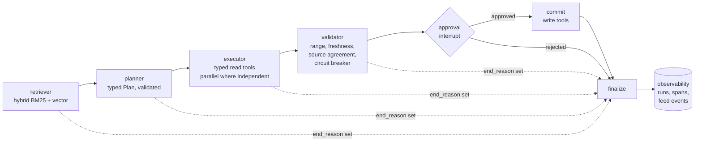

# Instrument onboarding agent

A LangGraph multi-agent system that handles three market data operations workflows (instrument onboarding, end-of-day price validation and vendor feed reconciliation) the way a regulated bank would want it to:

- every tool call is typed;
- every vendor response is validated;
- nothing is written without a human approving it;
- every run is observable.

It runs fully offline against mock vendor systems with fault injection. Claude (planner) and LangSmith (tracing) are optional switches.

> Personal weekend project. All vendor systems and data are fictional mocks (a few ISINs are real, public government bond identifiers; the prices, faults and reference records are invented). It is not affiliated with any employer and contains no proprietary code or data.

## Quickstart

```bash
uv venv --python 3.12 .venv && uv pip install --python .venv/bin/python -e ".[dev]"
source .venv/bin/activate

agent demo                       # run all 14 scenarios end to end, then print the report
agent run "Onboard the new US Treasury US91282CJL54 into the booking system"
agent pending                    # runs paused for approval
agent approve <run_id>           # or: --reject --comment "price looks off"
agent trace <run_id>             # every node, LLM call, tool call and approval decision
agent report                     # completion rate, end reasons, p50/p95 per node, cost per run
agent alerts                     # exit 1 if an alert fires
pytest -q && python evals/run_eval.py   # what CI runs
```

## Architecture



| Node | What it does |
|---|---|
| `retriever` | Ranks 10 operating procedures with BM25 + vector similarity, fused by reciprocal rank fusion |
| `planner` | Turns the request + top procedures into a `Plan` (workflow, ISIN, ordered steps). Steps are constrained to a fixed enum, including an explicit `escalate_to_human`. With Claude, a plan that fails validation is sent back with the exact error, once. |
| `executor` | Runs the read tools. Independent reads (both price feeds, reference data plus the booking check) run concurrently. Write steps are skipped here. |
| `validator` | Checks what came back: plausible range (catches a vendor switching from percent of par to a fraction), freshness, two-source agreement. It records each feed's health and builds the exact write payloads. |
| `approval` | Pauses the graph with `interrupt()` and shows the payloads and evidence. A SQLite checkpointer lets you resume from another process. |
| `commit` | Executes the approved writes |
| `finalize` | Records the run's end reason |

## Design decisions

**Typed tools, two kinds of error.** Every tool has a Pydantic args model and result model, and runs through `tools.call_tool`.
- *Bad arguments* come back as a readable message (`isin: String should match pattern ...`) so an LLM caller can fix the field.
- *Transient failures* (timeouts) are retried with exponential backoff.
- *Data errors* are never retried, because retrying bad data returns the same bad data.

**Reads and writes are separated.** Write tools (`create_instrument`, `publish_validated_price`, `flag_reconciliation_break`) only run in `commit`, after validation and approval. The approver sees the exact payload that will be written.

**Validate responses, not just requests.** The dangerous failure isn't the one that crashes but the one that succeeds with the wrong data. `XS3333333336`'s secondary feed returns `0.9915` instead of `99.15`: well-formed JSON with a valid float, but wrong. Without the range guard, reconciliation would raise a false break. With it, the run is rejected and the feed's failure is recorded.

**Circuit breaker per feed.** If too many recent responses from a feed fail validation, the agent stops writing for that feed and escalates with the evidence (`tests/test_graph.py::test_breaker_stops_writes_after_repeated_drift`).

**Every run ends with a reason.** The possible end reasons are `completed`, `escalated`, `rejected_by_validator`, `rejected_by_human`, `tool_error` and `timeout`. Task completion is the share of runs ending in `completed`. Every other reason is a failure bucket you can count and work down.

## Observability

Stored locally in SQLite (`.agent_data/observability.sqlite`), so it works with no external service:
- **runs:** request, workflow, ISIN, release, end reason and detail, tokens and cost;
- **spans:** one per node, LLM call, tool call (with arguments, attempts, status) and approval decision, each with latency;
- **feed events:** feed the circuit breaker.

`agent report` after a fresh `agent demo` (offline planner, so cost is 0):

```
Runs: 14   task completion: 43%   avg cost/run: $0.0000   run p95: 268 ms

End reasons:
  completed                  6
  escalated                  5
  rejected_by_validator      2
  timeout                    1

Latency per node (ms):       p50       p95
  executor                     89.5     271.1
  validator                     1.8       2.8
  ...
```

Completion is low on purpose: the scenarios are mostly failure cases. That is also why `agent alerts` fires after the demo (`ALERT: completion rate 43% below 60%`), which shows the alert path working. The rules (completion rate, tool error + timeout rate, run p95) live in `config.py`.

**LangSmith.** Set `LANGSMITH_TRACING=true` and `LANGSMITH_API_KEY`. LangGraph then sends full traces, with the run id and release as metadata, and `call_tool` appears as a nested tool span. For data that can't leave your network, point `LANGSMITH_ENDPOINT` at a self-hosted instance.

**Simulated latency.** Mock vendors sleep for a log-normal time around `AGENT_VENDOR_LATENCY_MS` (default 60; 0 in tests and CI), which makes per-node latency meaningful. Comparing `AGENT_PARALLEL_TOOLS=0` with `=1` over 42 runs, executor p50 drops from about 130 ms to 90 ms. p95 barely moves because it's dominated by a vendor that keeps timing out and is retried three times. That's the kind of thing per-node latency is for: parallelising helps the typical run, and the tail needs timeouts, not more parallelism.

## Evals and the release gate

`python evals/run_eval.py`:
1. **Retrieval** on `evals/golden_set.jsonl` (40 queries, each mapped to the procedure that should be retrieved): Recall@1, Recall@3 and MRR for BM25, vector and hybrid.
2. **Scenarios** (`evals/scenarios.jsonl`, 14 requests covering every failure mode): each must end with the expected end reason.

The gate fails if hybrid Recall@3 or MRR drops more than 0.02 below `evals/baseline.json`, or if any scenario changes outcome. `.gitlab-ci.yml` and `.github/workflows/ci.yml` run tests then the gate. After an intentional improvement, run `python evals/run_eval.py --update-baseline`.

The golden set is small and hand-written, so the absolute numbers say little. The point is the mechanism: a regression blocks the release. One real finding while building it: two onboarding scenarios failed because BM25 didn't match "Bund" to "Bunds", so a when-issued procedure ranked first. Adding light stemming fixed it, and the gate now guards it.

## Scenarios (mock data)

| ISIN | What it exercises | Expected |
|---|---|---|
| US91282CJL54, AU3TB0000192 | Clean onboarding | completed |
| DE0001102580 | Reference data times out once, retry succeeds | completed |
| FR0013508470 | Reference data always times out | timeout |
| XS2010031234 | Already booked (onboarding) / clean EOD price | escalated / completed |
| SG3260987654 | Vendor maturity before issue date | rejected_by_validator |
| XS1111111110 | Not in reference data | escalated |
| XS3333333336 | Secondary feed format drift | rejected_by_validator, then breaker |
| GB00BM8Z2S21 | Stale prices | escalated |
| XS2222222228 | Feeds disagree by 1.2%, so a real break is flagged | completed |

## Using Claude as the planner

```bash
uv pip install --python .venv/bin/python -e ".[llm]"
export ANTHROPIC_API_KEY=...          # AGENT_MODEL defaults to claude-sonnet-5-5
export AGENT_COST_PER_MTOK_IN=3 AGENT_COST_PER_MTOK_OUT=15   # set to your model's pricing
agent run "Please onboard the new 10y Treasury, ISIN US91282CJL54"
```

Without a key (or with `AGENT_OFFLINE=1`) the deterministic `ScriptedPlanner` is used. Tests and CI always use it, so they need no network. `tests/test_graph.py::test_planner_validation_error_is_fed_back_and_corrected` covers the Claude self-correction path with a fake model.

## Project layout

```
src/onboarding_agent/
  graph.py          nodes, routing, approval interrupt, Agent API
  planner.py        ClaudePlanner (structured output + error feedback) and ScriptedPlanner
  tools.py          typed tool registry and call_tool (validation, retries, spans)
  guards.py         price range / freshness checks and the circuit breaker
  vendors.py        mock reference data, pricing and booking systems, plus adapters
  observability.py  SQLite recorder, node decorator, report and alerts
  retrieval/        hybrid retriever and the procedure corpus
  cli.py            `agent` command
evals/              golden set, scenarios, baseline, run_eval.py
tests/              unit and end-to-end tests
```

## Ideas for extending it

- Swap the TF-IDF vector leg for real embeddings (`AGENT_EMBEDDINGS=sentence-transformers`) and compare against the baseline.
- Let the executor ask Claude for tool arguments, so the bad-args feedback loop is exercised live.
- Add an LLM-as-judge eval for the evidence shown to approvers.
- Export spans as OpenTelemetry to Grafana instead of SQLite.
